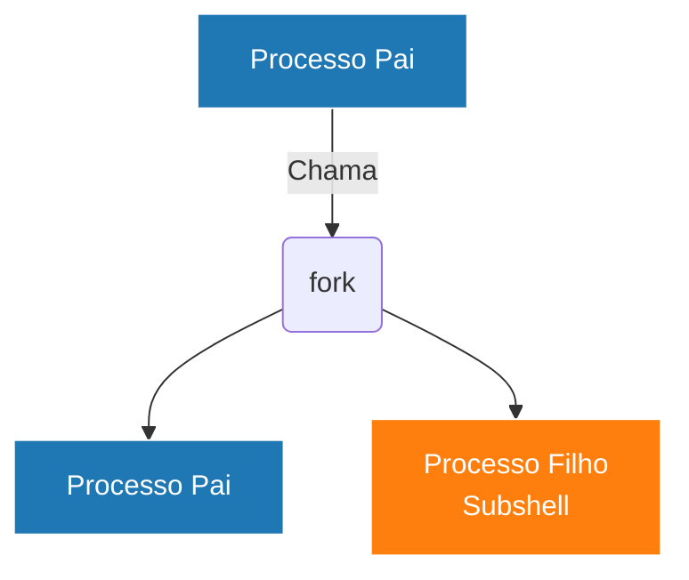
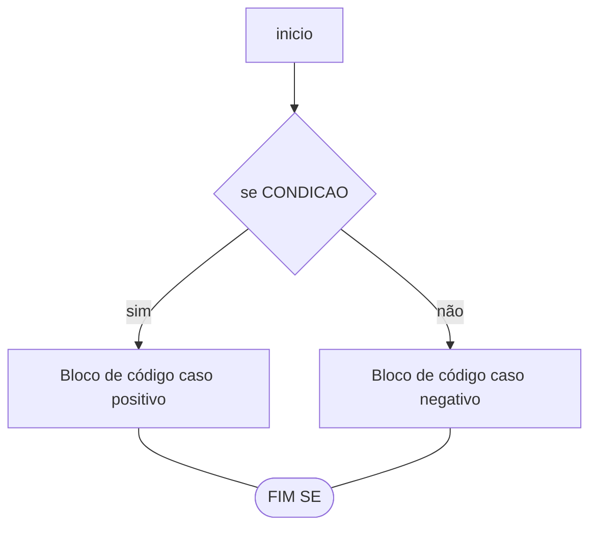

# Compreendendo o `shebang`
## SHEBANG
De acordo com uma pesquisa rápida, o termo `shebang` vem da junção dos dois caracteres que antecedem a indicação do interpretador que será evocado. Ou seja, a contrasão de "#" (do inglês **_hash_**) e "!" (de uma giria inglesa **_bang_**).
Na criação de scripts, a primeira linha é utilizada para indicar qual interpretador daquele script será utilizado, por exemplo, se for um script em python (.py) será o interpretador `python`, caso seja um shell script (.sh) algum terminal do sistema que interprete a linguagem, como o `bash`.
Portanto, se no script, conter o caminho do interpretador, podemos executar o script, sem explicitamente indicar o interpretador no comando, ou seja, o script é executado apenas com a evocação de seu nome (usualmente precedido de `./`).

**Sem shebang**
 > ```bash
> python3 script.py
> ```
> ```bash
> bash script.sh
> ```
**Com shebang**
>```bash
> ./script.py
> ```
> ```bash
> ./script.sh
> ```
O `shebang` pode ser declarado de duas formas no script:
> ```txt
> !#/usr/bin/<interpretador>
> ```
ou
> ```txt
> !#/usr/bin/env <interpretador>
> ```

De forma resumida, o primeiro método procura o interpretador obrigatoriamente no diretório `\usr\bin`, enquanto o segundo utiliza um método de busca dinâmico, avaliando os `paths` declarados nas variáveis de ambiente do sistema, varrendo-o e procurando onde o interpretador esta instalado, através do mecanismo `env`. Este torna o script mais versátil quando for utilizado em diferentes sistemas.

## Prática
Para constatar a diferença entre escrever um script com e sem shebang.
1) Interpretando um script python:
- [ ] Crie um arquivo chamado `sem_shebang.py`
- [ ] Dentro do arquivo, adicione a seguinte linha de comando:
    ```python
    print("Este é um script python sem shebang!")
    ```
- [ ] Salve o arquivo, atribua permissão e tente executá-lo duas formas:
    ```bash
    ./sem_shebang.py
    ```
    ```bash
    python3 sem_shebang.py 
    ```
- [ ] Crie um arquivo chamado `com_shebang.py`
- [ ] Dentro do arquivo, adicione a seguinte linha de comando:
    ```python
    #!/usr/bin/python3
    print("Este é um script python com shebang!")
    ```
    ou

    ```python
    #!/usr/bin/env python3
    print("Este é um script python com shebang!")
    ```
- [ ] Salve o arquivo, atribua permissão e tente executá-lo das duas formas: 
    ```bash
    ./com_shebang.py
    ```
    ```bash
    python3 com_shebang.py 
    ```

2) Interpretando um shell script:
- [ ] Crie um arquivo chamado `sem_shebang.sh`
- [ ] Dentro do arquivo, adicione a seguinte linha de comando:
    ```sh
    echo "Este é um script shell sem shebang!"
    ```
- [ ] Salve o arquivo, atribua permissão e tente executá-lo das duas formas:
    ```bash
    ./sem_shebang.sh
    ```
    ```bash
    bash sem_shebang.py 
    ```
- [ ] Crie um arquivo chamado `com_shebang.sh`
- [ ] Dentro do arquivo, adicione a seguinte linha de comando:
    ```sh
    #!/usr/bin/bash
    echo "Este é um script shell com shebang!"
    ```
    ou

    ```sh
    #!/usr/bin/env bash
    echo "Este é um script shell com shebang!"
    ```
- [ ] Salve o arquivo, atribua permissão e tente executá-lo das duas formas: 
    ```bash
    ./com_shebang.py
    ```
    ```bash
    bash com_shebang.py 
    ```

Verifique/responda: Em qual das execuções a saída do terminal indicou erros?

---

# Variáveis Locais, de Ambiente e o Subshell

## Variáveis
Como o conceito clássico de programação, variáveis são valores dinâmicos, ou, como o nome sugere, são estruturas no programa/sistema que variam.
Trazendo o conceito para Shell script GNU/Linux, (Ou programas e sistemas operacionais). De forma resumida, as variáveis podem se apresentar de duas formas: Variáveis locais e variáveis de ambiente.

**- Variáveis de ambiente:** São estruturas declaradas e gravadas diretamente no sistema operacional. Existem para facilitar o gerenciamento do sistema, diminuindo e necessidade de efetuar comandos com instruções extensas no terminal. Facilitando o desempenho de serviços que rodam no sistema, assim como auxiliando o administrador.
cada sistema tem um comando específico para listar as variáveis de ambiente. No caso de sistemas linux ,unualmente, os comandos são `env` ou `set`.
> Lembrando que esta não é uma característica de sistemas Linux. Sistemas Mac também contém variáveis de ambiente, assim como sistemas Windows também.

**- Variáveis Locais:** São variáveis restritas apenas durante a sessão atual, ou evocadas e utilizadas por scripts e programas durante sua execução, ou seja, Encerrar uma sessão ou um processo, usualmente "mata" as variáveis declaradas naquele momento. Iportante ter em mente que é possível tornar uma variável local com escopo de uma ambiente, "promovendo-a" com o comando `export`, assim como é possível remover uma variável da sessão com o comando `unset`.

A declaração de uma variável no shell (tanto no terminal quanto no script) segue a seguinte sintaxe:
```sh
VARIAVEL=<valor>
```

para evocá-la, na maioria das vezes, é necessário colocar o sifrão ($) na frente da variável, por exemplo, para verificar seu conteúdo no terminal:
```bash
echo $VARIAVEL
```
Importante ter em mente que, na definição da variável, sua declaração e atribuição de valor não devem conter espaços. Além disso, apesar de não obrigatório, é bastante comum declararmos as variáveis em Shell Script com letras maiúsculas.

Porém, como uma variável local é removida ao término de um script sem reiniciar a sessão? Ou melhor, como a variável não entra em conflito com outra de outro script ou serviço?
Isso é possível porque existe um conceito de `subshell`.

## Subshell
Um `subshell`, basicamente, é um shell que é evocado pelo terminal da sessão atual para executar, de forma isolada, scripts e serviços, deixando a sessão atual "intacta". Isso explica porque variáveis não se acumulam ou conflitam entre programas.
A sessão atual pode ser conhecida como `Processo pai`, e quando há a necessidade de uma execução isolada de comandos (o que ocorre direto, de forma invisível, durante uma sessão) o "Pai" evoca um `processo filho`, que executa o comando/serviço e depois, encerra-se. Este processo de evocar um (ou mais) processos "Filhos" é comumente chamado de `fork`:


**FONTE:** Adaptado de  _Fabio Costa Engenharia - WordPress.com_

## Tipagens
Váriaveis em shell script, apesar de suas semelhanças com as variáveis de linguagens de programação tradicionais, como python, javaScript e afins, ela não possui uma tipagem tão rígida ou bem definida, o que pode confundir programadores de outras linguagens. Para este inicio, consideraremos que as variáveis em shell possuem **propriedades**, futuramente, podemos explorar sobre como modificar melhor seu comportamento com comandos como `declare`. (Essa foi a melhor forma que encontrei de entender como elas funcionam, por enquanto)
Portanto, temos que as propriedades são:
1. Toda variável é, nativamente, tratada como uma `string`;
2. Apesar de serem, em essência strings, quando compostas apenas por caracteres numéricos, o shell consegue interpretar contas matemáticas;
3. Como não possuem uma tipagem convencional, elas não contam com propriedades booleanas.

Considerando as observações acima, no momento que precisarmos de comparações para estruturas condicionais, poderemos utilizar de outras estruturas e artifícios do sistema linux para considerarmos decisões. Portanto, neste momento, sobre tipagens, o nível de abstração conceitual em comparação com outras linguagens tem que ser maior.

## Prática
Declarar e consultar as variáveis de ambiente e locais declaradas, assim como verificar o subshell da sessão.

- [ ] Consultar as variáveis de ambiente existentes com comando `env` ou `set`
- [ ] Criar uma variável
    ```bash
    TESTE="Essa é uma variável de teste!"
    ```
- [ ] Imprimir o conteúdo da variável `TESTE` com o comando `echo`
- [ ] Verificar a variável de ambiente que indica o `SHLVL` (shell level) da sessão atual
    ```bash
    echo $SHLVL
    ```
- [ ] Forçar um subshell com o comando `bash` e consultar novamente a variável `SHLVL`
- [ ] Efetuar um `echo` na variável `TESTE` criada anteriormente
- [ ] Sair do subshell criado com `exit`.
- [ ] Consultar se a variável `TESTE` ainda existe na sessão principal.
- [ ] Fazer logout do sistema, logar novamente e consultar mais uma vez a existência da variável `TESTE`.

---

# Lidando com Argumentos e se Comunicando com o Usuário

# Argumentos

Relembrando a estrutura de um comando no terminal, temos que os `argumentos` (também conhecidos como parâmetros e alvos) são elementos que são declarados logo após a evocação de um script ou comando (`<comando> [opcao\flag] <argumento\alvo>`) afim de fornecer ao comando/script dados e informações para que o computador os processe, como por exemplo:
```bash
mkdir nova_pasta
```

O comando é o `mkdir`, e o argumento é `nova_pasta`, ou seja, o sistema irá criar um novo diretório de nome `/nova_pasta`.
Este conceito é aplicável para os nossos scripts shell.
Ao identificar os argumentos, o Linux os guarda dentro de estruturas chamadas `variáveis posicionais` enumeradas.

> Lembrar que o `espaço` entre comandos, opções e argumentos é considerado o separador do `bash`.

Para ele enumerar os argumentos, o Linux identifica a ordem que os argumentos foram fornecidos:
```bash
<comando> argumento1 argumento2 ... argumentoN
```

Para consultar e interagir com estes argumentos, podemos entender que o shell os organiza da seguinte forma:
#### Variáveis posicionais
| Variável | Significado |
| :---: | :--- |
| `$0`| Último comando bem sucedido, geralmente o próprio comando/script |
| `$1` a `$9` | 1º ao 9º argumento |
| `${10}` em diante | 10º argumento em diante, deve ser referenciado com os chaves para evitar concatenação entre variáveis.

Existem também as `Variáveis Especiais de Controle`, que ajudam na manutenção de scripts mais robustos.
#### Variáveis Especiais de Controle
| Variável | Significado |
| :---: | :--- |
| `$#`| Armazena a quantidade total de argumentos passados (ignorando o `$0`) |
| `$@` | Agrupamento de todos os argumentos passados |
| `$*` | Idem ao `$@`, porém, não recomendado quando os argumentos contém espaços |

# Saída: O comando `echo`
Neste ponto, não deve ser novidade que o comando `echo` é o principal vetor de comunicação entre usuário e maquina. Qualquer resposta impressa no terminal, por qualquer comando, é realizado, provavelmente, pelo `echo`.
Para melhorar a formatação do texto no terminal, o `echo`, assim como qualquer outro comando, utiliza-se de flags/opções para indicar novas funções, incluindo a interpretação de `caracteres de escape` (`metacaracteres`).
as três principais opções do `echo` são:
* `-n`: Remove a quebra de linha automática no final do texto.
* `-e`: Habilita a interpretação de caracteres de escape (metacaracteres que iniciam com a barra invertida `\`)
* `-E`: Desabilita a interpretação dos caracteres de escape, usualmente já é o padrão do comando.

O `echo` interpreta o textos com aspas duplas (`"`), simples (`'`) ou, sub certas condições, sem as aspas. Porém, a utilização de cada uma das formas tem uma característica única:
* Aspas simples: Textos em aspas simples são interpretados de forma literal, portanto, o `echo` passa a ignorar todos os caracteres especiais, imprimindo **LITERALMENTE** o que está entre as aspas, ou seja, qualquer variável declarada que você queira imprimir seu valor, não terá seu valor impresso, mas sim sua estrutura de declaração. Este conceito se expande para qualquer outro carácter, tais quais `\`, `$`, `!` etc.  É bastante útil quando se deseja imprimir estes símbolos na tela.
* Aspas duplas: Textos declarados entre aspas duplas permitem que o interpretador compreenda os caracteres especiais, considerando a influência dos símbolos `$`, `!`, `\` etc., antes de entregar o texto formatado no terminal. É a forma mais recomendada de se usar, mesmo que nenhuma variável ou formatação específica seja utilizada.
* Sem aspas: A exceção para a utilização do `echo` sem nenhuma aspas, geralmente, é para verificar variáveis, porém, mesmo que o único argumento de `echo` seja uma variável isolada, se o conteúdo dela contiver espaços, o `echo` irá interpretar que cada dado, após um espaço dentro da variável é um argumento, portanto, mesmo que o argumento seja uma variável isolada, é ideal colocá-la entre aspas duplas.

### Metacaracteres
De forma resumida, metacaracteres são estruturas especiais que permitem que um comando aja de forma específica quando encontra uma combinação especifica de simbolos.
Para o `echo -e`, alguns metacaracteres bastante úteis são:
#### Metacaracteres
| Metacaractere | Função |
| :---: | :--- |
| `\n` | Permite quebrar\pular uma linha no meio de uma frase |
| `\t` | Adiciona um recuo (espaço de `TAB`) à saída |
| `\\` | Possibilita a impressão literal da barra invertida, cancelando seu efeito de "escape" |
| `\c` | Corta a string, não imprimindo o conteúdo após sua utilização, ele também impede a quebra de linha nesse processo |

## Prática

Criar um script que receba argumentos, e interagir com eles, imprimindo mensagens com `echo`.

- [ ] Crie um script chamado `teste_argumentos.sh` com o conteúdo abaixo
    ```sh
    #!/usr/bin/env bash
    # Este script é apenas uma sugestão para interagir com argumentos
    # Pode modificá-lo da forma que for mais interessante para esse objetivo
    # 
    echo -e "$0 inicializado"
    echo -e "O primeiro argumento passado foi: $1"
    echo -e "Logo, o segundo foi: $2"
    echo -e "Porém, o total de argumento é $#"
    echo -e " E foram estes aqui:\n$@"
    ``` 
- [ ] Passe diversos parâmetros ao script
    - [ ] Modifique as mensagem do `echo` utilizando aspas simples
    - [ ] Verifique a utilização de aspas na passagem do argumento
    - [ ] Passe variáveis de ambiente e afins
    - [ ] Modifique a ordem em que eles são impressos.

---

# Estrutura IF e Comparações

## Estrutura `if/else`

Estruturas condicionais são instruções em programação que ajudam o script a tomar decisão, graças à elas que, maior parte de filtros e decisões ajudam na automação de tarefas, pois com eles, podemos retratar `algoritmos`, através de estruturação logica do script.
Em scripts shell, existem dias estruturas condicionais, a mais famosa delas é a `if/else`.
**If** e **else**, em inglês significam, respectivamente, **Se** e **Se não / Caso contrário**. Utilizando-se de um linguajar mais "portugol" seria uma estrutura, dentro de um programa/script seguindo essa ideia:
```portugol
SE <condicao>, entao
    <Bloco_de_codigo_se_condicao_for_verdadeira>
SE NAO
    <Bloco_de_codigo_se_condicao_for_falsa>
FIM SE
```



Traduzindo para Shell script:
```sh
if [ <condicao> ]
then
    <bloco_de_codigo_caso_condicao_atendida>
else
    <bloco_caso_condicao_nao_atendida>
fi
```

Como em linguagens mais comuns, podemos ter diversas condições para atender, portanto, aninhamos as decisões, que o programa irá varrê-las, uma a uma, ate que encontre a correspondente. Para aninhar condições. utilizamos a estrutura `elif`:
```sh
if [ <condicao1> ]
then
    <bloco_de_codigo_caso_condicao1_atendida>
elif [ <condicao2> ]
then
     <bloco_de_codigo_caso_condicao2_atendida>
.
.
.
elif [ <condicaoN> ]
then
     <bloco_de_codigo_caso_enessima_condicao_atendida>
else
    <bloco_caso_condicao_nao_atendida>
fi
```
---

## Operadores Comparativos

Para efetuar a validação das condições, devemos utilizar os **operadores comparativos**. Estes são responsáveis por indicar para o script como ele como verificar se os elementos são iguais, maiores, diferentes etc.
Porém, em scripts shell, existem maneiras diferentes de você comparar **números inteiros** e **textos/strings**
Operadores comparativos numéricos são declarados através da abreviação de palavras em inglês:
#### Operadores comparativos numéricos
| Operador | significado (Inglês) | Teste lógico | exemplo |
| :---: | :--- | :--- | :--- |
| `-eq` | equal | Igual a | [ "$IDADE" -eq 18 ] |
| `-ne` | not equal | Diferente de | [ "$STATUS" -nq 0 ] |
| `-gt` | greater than | Maior que | [ "$TENTATIVAS" -gt 3 ] |
| `-ge` | greater than or equal | Maior ou igual a | [ "$SALDO" -ge 100 ] |
| `-lt` | less than | Menor que | [ "$DIAS" -lt 7 ] |
| `-le` | less than or equal | Menor ou igual a | [ "$TAMANHO" -le 1024 ] |

Apesar de contraintuitivo, os comparadores de textos, que são utilizados para analisar strings, diretórios, arquivos etc. são os operadores matemáticos. Apesar de estranho, essa decisão de estrutura faz sentido, pois evita que, ao utilizá-los em números, arquivos sejam criados acidentalmente, já que o símbolo `>`, no terminal, é utilizado para encaminhar algo para um arquivo, por exemplo.
#### Operadores comparativos de texto (strings)
| Operador | Teste lógico | exemplo |
| :---: | :--- | :--- |
| `-=` ou `==` |Textos são **EXATAMENTE** Iguais | [ "$USUARIO" = "root" ] |
| `!=` | Textos são Diferentes | [ "$RESPOSTA" != "sim" ] |
| `-z` | Verifica se a string está vazia (Zero Length) | [  -z "%TOKEN" ] |
| `-n` | Verifica se a string não está vazia (Non-zero) | [ -n "$NOME" ] |

> Os espaços entre as condições e colchetes é crucial, assim como colocar espaços entre o operador comparativo e os elementos comparados na condição.

---

## Flags do `If`

Além dos operadores condicionais poderem ajudar muito nas avaliações logicas do script, é importante ter em mente que a estrutura `if` também aceita `flags\opções`. Relembrando a estrutura de um comando, podemos dizer que a condição é o argumento do comando `if`.
Algumas flags uteis podem auxiliar na verificação de existência de arquivos, diretórios, permissões e afins.

### Flags de Verificação de Arquivos e Diretórios

| Flag | Significado | O que testa | Exemplo de uso |
| :--- | :--- | :--- | :--- |
| **`-e`** | **e**xists | Se o item **existe** (pode ser arquivo, pasta ou link). | `[ -e "/etc/passwd" ]` |
| **`-f`** | **f**ile | Se existe E é um **arquivo comum** (ignora pastas). | `[ -f "$arquivo_log" ]` |
| **`-d`** | **d**irectory | Se existe E é um **diretório** (pasta). | `[ -d "/var/backups" ]` |
| **`-s`** | **s**ize | Se o arquivo existe e **não está em branco (Non-zero)** (não está vazio). | `[ -s "$meu_relatorio.txt" ]` |

### Flags de Verificação de Permissões

| Flag | Significado | O que testa | Exemplo de uso |
| :--- | :--- | :--- | :--- |
| **`-r`** | **r**ead | Se o item existe e o script tem permissão para **ler**. | `[ -r "$config" ]` |
| **`-w`** | **w**rite | Se o item existe e o script tem permissão para **escrever/alterar**. | `[ -w "/var/log/syslog" ]` |
| **`-x`** | e**x**ecute | Se o item existe e o script tem permissão para **executar** (ou abrir, se for pasta). | `[ -x "./script_auxiliar.sh" ]` |

### Operadores Lógicos (Inversão e Combinação)

| Operador | Significado | O que faz | Exemplo prático |
| :--- | :--- | :--- | :--- |
| **`!`** | NOT (Negação) | Inverte qualquer flag. Torna o verdadeiro falso e vice-versa. | `[ ! -d "$pasta" ]` (Se a pasta NÃO existir) |
| **`-a`** | AND (E) | Ambas as condições dentro do mesmo `[ ]` devem ser verdadeiras. | `[ -f "$arq" -a -w "$arq" ]` (Se é arquivo E pode ser editado) |
| **`-o`** | OR (OU) | Pelo menos uma das condições deve ser verdadeira. | `[ "$uid" -eq 0 -o "$uid" -eq 1000 ]` |

---

## Prática

utilizar uma estrutura `if` para melhorar o script `teste_argumentos.sh`, verificando se ao menos, dois argumentos foram passados ao script.

- [ ] Abrir o arquivo `teste_argumentos.sh` e editá-lo com a estrutura `if`, caso não exista, criar um novo arquivo com o conteúdo abaixo:
    ```sh
    #!/usr/bin/env bash
    # Este script é apenas uma sugestão para interagir com argumentos
    # Pode modificá-lo da forma que for mais interessante para esse objetivo
    # 
    if [ "$#" -lt 2 ]
    then
        echo -e "Passe ao menos, dois argumentos"
    else
        echo -e "$0 inicializado"
        echo -e "O primeiro argumento passado foi: $1"
        echo -e "Logo, o segundo foi: $2"
        echo -e "Porém, o total de argumento é $#"
        echo -e " E foram estes aqui:\n$@"
    fi
    ``` 
- [ ] Teste passando nenhum argumento, depois passando um, e novamente passando dois ou mais

---

# O Comando read e a condição case

## Case

A segunda estrutura condicional em shell é o `case`, que, numa tradução livre para o português, significa **caso**. Essa estrutura verifica se o valor definido foi atribuído a um argumento ou recebido em uma variável.
Sua estrutura é a seguinte:
```sh
case "$VARIAVEL" in
    <valor1>)
        <Bloco_caso_valor1_seja_igual_ao_conteudo_da_$VARIAVEL>
        ;;
    <valor2>)
        <Bloco_caso_valor2_seja_igual_ao_conteudo_da_$VARIAVEL>
        ;;
    .    
    .
    .
    <valorN>)
        <Bloco_caso_valorN_seja_igual_ao_conteudo_da_$VARIAVEL>
        ;;
    *)
        <Bloco_caso_nenhum_valor_seja_igual_ao_conteudo_da_$VARIAVEL>
        ;;
esac
```
A estrutura `case` pode ser facilmente associada ao funcionamento do aninhamento de condições com `if/elif`, porém, suas principais diferenças são:
- Case não testa todas as condições, ele simplesmente pula para o bloco onde a condição satisfaz o valor;
- Em termos de leitura de código, é muito mais limpo do que ler diversas linhas de condições aninhadas;
- É a estrutura mais recomendada para a criação de estruturas de scripts que interajam recebendo valores dinamicamente do usuário, além dos argumentos

Portanto, o `case` é excelente para a criação de menus interativos, oferecendo uma versatilidade nos códigos adicional, simplificando os testes de condições, principalmente se estas forem comparações exatas.

> Tanto o `case` e o `if` são encerrados com a escrita de suas estruturas de trás para frente:
if condicao -> inicio da condicional if
then
fi -> fim da condicional if<br>
case "$VARIAVEL" in -> Inicio da estrutura case
    valor1)
        ;;
    *)
        ;;
esac -> fim da estrutura case

## Comando `read`

É possível realizar  interação com usuário durante a execução do script, e não apenas através da coleta de informações por argumentos..
Para permitir que o sistema capture uma entrada do usuário no terminal, utilizamos o comando `read`, e armazenamos a entrada em uma `variável`.
A estrutura básica de utilização do `read` é:
```bash
read VARIAVEL
```

O `read` conta com diversas flags que podem ser muito úteis durante a confecção de um script shell. As mais interessantes são:
#### Flags do `read`
| Flag | Significado | O que Faz |
| :--- | :--- | :--- |
| **`-p`** | **p**rompt | Permite imprimir uma mensagem, sem utilizar `echo` | 
| **`-s`** | **s**ilent / secret | Omite a entrada do usuário enquanto digita |
| **`-t`** <segundos> | **t**imeout | Define um temporizador para o usuário começar a digitar, falhando o `read` silenciosamente e continuando o script |
| **`-n`** <quantidade> | **n**umber of characteres | Encerra o `read` assim que uma quantidade especifica de caracteres é digitada pelo usuário |   
| **`-r`** | **r**aw | Evita que o `bash` interprete a barra invertida `\` como metacaractere, ou seja, captura o texto puro/literal | 

Assim como todo comando do terminal, o `read` identifica espaços como um separador, possibilitando que mais de uma variável seja capturada em apenas uma entrada, desde que sejam separadas por um espaço:
```bash
read -r -p "Digite seu Nome e Sobrenome: " NOME SOBRENOME
echo "Seu primeiro nome é: $NOME"
```
 ---

## Pratica

Envia uma mensagem de saudação de acordo  com a entrada do usuário.

- [ ] Crie um arquivo de nome `saudacao_com_periodo.sh`
- [ ] Coloque o conteudo dentro do arquivo criado:
    ```sh
    #!/usr/bin/env bash
    # Script imprime uma saudação de acordo com o período do dia informado
    
    read  -r -p "Informe o período do dia (manha/tarde/noite): " PERIODO
    
    case $PERIODO in
        manha)
            echo -e "Bom dia!\n Já tomou um cafezinho hoje?"
            ;;
        tarde)
            echo -e "Boa tarde!\n Bora almoçar!"
            ;;
        noite)
            echo -e "Boa noite!\n Vamos embora, deixe um pouco pra amanhã!"
            ;;
        *)
            echo -e "Não tenho certeza se entendi direito, porém:"
            echo -e "Bom dia, boa tarde e boa noite!"
            ;;
    esac

- [ ] Teste com diversas entradas

---

# Loopings

## Looping

`Loopings` (ou **laços de repetição**) são estruturas que, de modo geral, repetem um mesmo bloco de instruções, até que a condição seja satisfeita.
Em scripts shell existem 3 estruturas de loopings.

## `while`

A estrutura `while` repete um bloco de código **enquanto** a condição apresentada a ele é atendida/verdadeira.
Sua estrutura em shell é a seguinte
```sh
while [ <condicao> ]
do
    <bloco_de_instrucoes_para_repetir>
done
```
### Pratica `while`

Fica solicitando uma entrada para o usuário, enquanto ele digitar **sim** a pergunta é repetida.

- [ ] Criar um script chamado `continuar.sh`
- [ ] Colocar o código a seguir e verificar o funcionamento
    ```sh
    #!/usr/bin/env bash
    # Insistentemente pede para o usuario digitar se quer continuar ou não
    
    CONTINUAR=sim
    
    while [ "$CONTINUAR" = sim ]
    do
        read -r -p "Deseja continuar? [sim/nao} " CONTINUAR
    done
    ```

## `until`

A estrutura `until` é semelhante ao `while`, e funciona de forma complementar.
O `until` repete um bloco de instruções **até que** a condição seja atendida/verdadeira.
sua estrutura é a seguinte:
```sh
until [ condicao ]
do
    <bloco_de_instrucoes_para_repetir>
done
```

### Prática `while`

Fica solicitando uma entrada para o usuário, a pergunta é repetida até que o usuário digite **nao**

- [ ] Criar um script chamado `continuar.sh`
- [ ] Colocar o código a seguir e verificar o funcionamento
    ```sh
    #!/usr/bin/env bash
    # Insistentemente pede para o usuário digitar se quer continuar ou não
    
    CONTINUAR=sim
    
    until [ "$CONTINUAR" = nao ]
    do
        read -r -p "Deseja continuar? [sim/nao} " CONTINUAR
    done
    ```
Tanto `until` quanto o `while` podem ser úteis para avaliar confirmações com o usuário, além de poderem repetir instruções uma quantidade predeterminada de vezes, controlando uma variável que sirva como contadora, apesar de serem utilizados quando o número de iterações não é bem definido.
Apesar de num primeiro momento, serem extremamente parecidos e, por conta de outras linguagens, o `while` ser o favorito e mais conhecido, a utilização de um ou outro ainda é bastante situacional e, considerando o teste na variável como sendo "sempre falso", o `until` vem a calhar, mantendo um código limpo, uma vez que evita a utilização desnecessária de operadores lógicos.
Além disso, as duas estruturas fornecem uma segurança quando uma condição deve ser bastante específica.

## `for`

O loop `for` é o mais indicado quando falamos de ações em que tem uma repetição predefinida, portanto, ações que exijam contagem, geralmente, são resolvidas com o `for`. Isso ocorre pois o `for` costuma iterar em cima de intervalos bem definidos, sendo muito útil, por exemplo, para percorrer uma lista de elementos. Uma definição, trazendo uma tradução literal para o português, seria que **para cada elemento, faça algo**.
O for é bastante versátil, como ele consegue iterar listas, é bastante utilizado para verificar itens em diretórios ou efetuar ações em diversas variáveis, portanto, sua estrutura base pode variar de acordo com o argumento que ele interage. Verifiquemos algumas estruturas úteis, inicialmente, para declarar o `for`:
### Sintaxe para contador
```sh
for CONTADOR in {inicio..fim..salto}
do
    <bloco_de_isntrucoes_para_repeticao>
done
```

## Iterando em uma sequência de variáveis/argumentos
```sh
for ARGUMENTO in "argumento1" "argumento3" "argumentoN"
do
    <bloco_de_isntrucoes_para_repeticao>
done
```
### Prática `for`

Fazer um script que realize a contagem de 1 até 10 a cada 1 segundo.
- [ ] Crie um arquivo chamado `contador_basico.sh` e coloque o seguinte conteúdo nele
    ```sh
    #!/usr/bin/env bash
    # Script conta de 1 até 10
    
    for CONTADOR in {1..10}
    do
        echo "$CONTADOR"
        sleep 1
    done
    ```
 - [ ] Modifique o script para que ele realize uma contagem **decrescente**
 
Criar um script que receba nomes como argumentos e imprima uma mensagem de "Bem-vindo" para cada nome passado.
- [ ] Crie um arquivo chamado "bem_vindo_em_massa.sh" e coloque as seguintes instruções no arquivo
    ```sh
    #!/usr/bin/env bash
    # Script da boas vindas aos usuários recebidos como parâmetro
    
    for NOME in "$@"
    do
        echo "Bem-vindo, $NOME"
        sleep 1
    done
    ```
- [ ] Testar a saída passando diversos argumentos ao script
